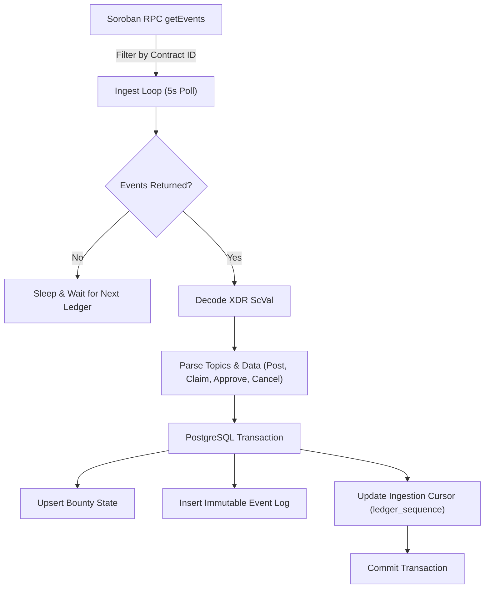

# SoroQuest Indexer: Event Ingestion Architecture & Resiliency

This document details the architectural design, polling strategy, error handling, and replay mechanics of `soroquest-indexer`.

---

## Cursor Tracking & At-Least-Once Delivery
- **Ledger Watermark**: The cursor is stored in the `indexer_cursor` table.
- **Atomic Progress**: State updates, event logs, and the cursor update execute within a single PostgreSQL transaction (`BEGIN ... COMMIT`).
- **Idempotency**: If the service restarts mid-poll, transactions roll back. The next poll begins from `last_ledger`, preventing duplicated state transitions or skipped bounties.
- **XDR Decoding**: Soroban events emit raw XDR ScVals. The decoder validates schema structures before database writes.
